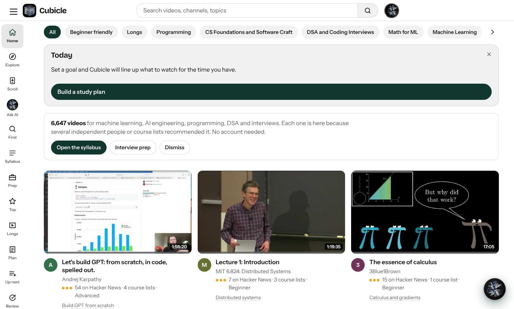
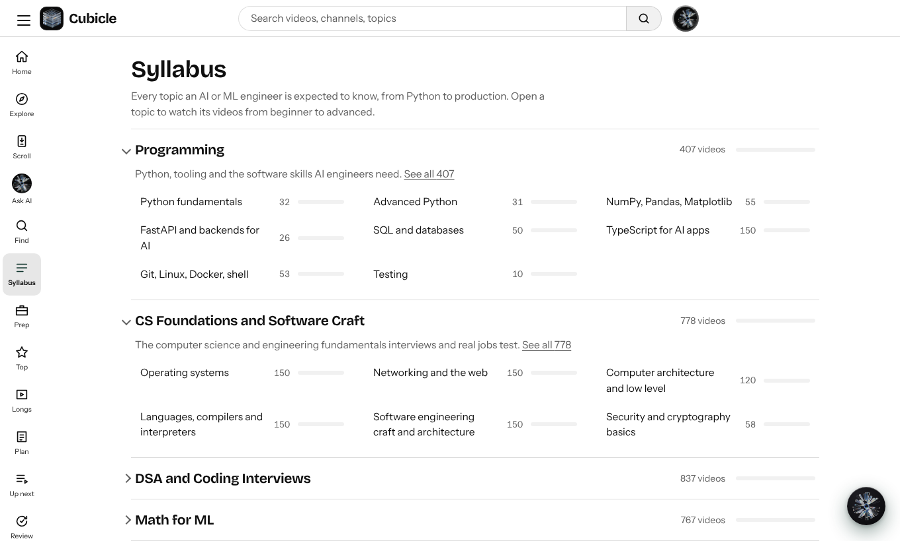
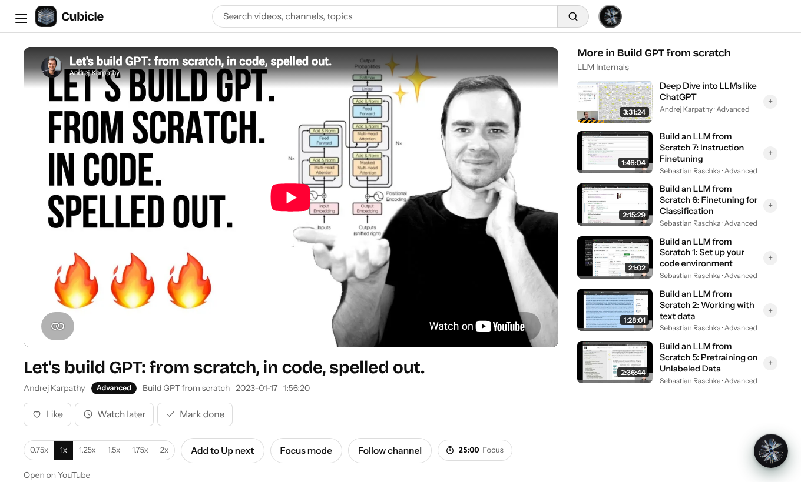
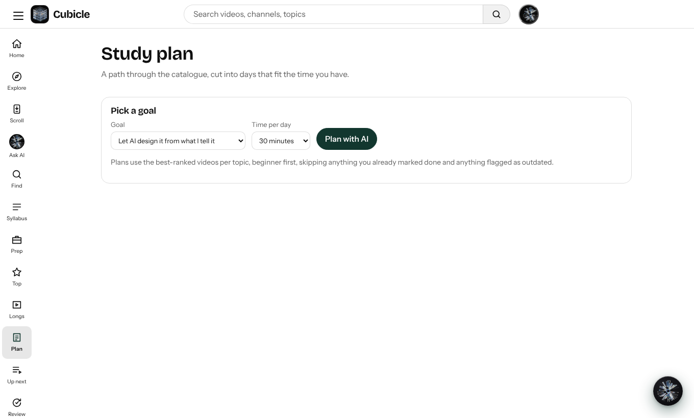
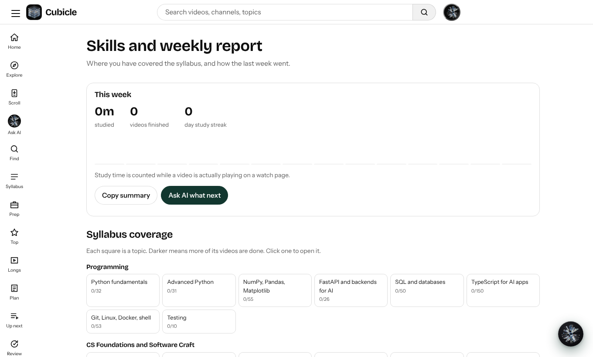
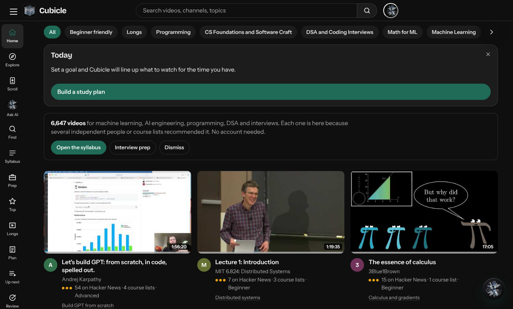
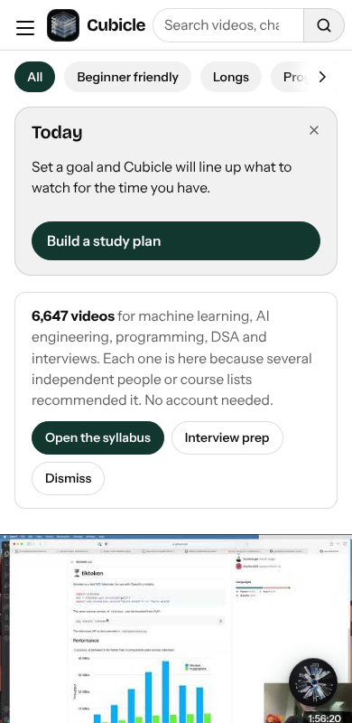

# Cubicle

**A quiet place to learn AI and ML from YouTube, using only videos that several independent people recommend.**

Cubicle is a free, login-free catalogue of the best YouTube videos for machine learning, AI engineering, programming, DSA, system design and interview prep, laid out as a syllabus. A video is listed only when more than one independent source vouches for it: Hacker News commenters, university course pages, GitHub roadmaps, and a short list of trusted channels. On top of the catalogue sit study tools: notes, spaced review, a daily plan, focus mode and an optional AI study guide.

There are no accounts and no tracking. Your progress lives in your own browser.

Inspired by Andrej Karpathy's [HackerTube](https://hackertube.org). Cubicle narrows the idea to one audience and adds a learning order, freshness scoring and a study layer.



---

## Features

- **Syllabus:** 12 sections and about 100 topics, from Python to LLM internals to MLOps
- **Why it is here:** each video shows how many Hacker News users and course lists recommended it
- **Freshness:** a freshness bar on every video, and a "May be outdated" tag on old tool-specific tutorials
- **Library:** Liked, Watch later and Done, with a progress page and undo
- **Explore:** what is happening in AI right now, from Hacker News, lab blogs, papers and new repos
- **Ask AI:** a study guide that searches the catalogue, builds a plan, and quizzes you
- **Shortcuts:** `j` / `k` move, `w` save, `d` done, `/` search, `n` note, Ctrl or Cmd + K command palette
- **Themes:** light and dark, responsive down to phones, installable as an app

| Syllabus | Watch page |
| --- | --- |
|  |  |

| Study plan | Skill map |
| --- | --- |
|  |  |

| Dark | Mobile |
| --- | --- |
|  |  |

---

## Study Tools

Everything below is local to the browser (key `devtube.study.v1`). Use Settings, Export progress to move it between devices.

| Feature | Where |
| --- | --- |
| Today card, time budget chips (15, 30, 60 min), study plan from a track or section, or built by Ask AI (`save_plan`) | Home, `#/plan` |
| Timestamped notes (press `n` to stamp), click to seek, Markdown export | Watch page |
| Resume position, remembered playback speed, Up next queue with auto-next and "fit to N minutes" | Watch page, `#/queue` |
| Spaced review at 3, 7, 30, 90 days for Done videos and Shorts "Got it", with "Quiz me with AI" | `#/review` |
| Focus mode and a 25/5 Pomodoro timer. Study time is counted only while a video plays | Watch page |
| Skill map (syllabus coverage and gaps) and weekly report | `#/skills` |
| Follow channels and topics, "New for you" feed | `#/following` |
| Command palette (Ctrl or Cmd + K) | Everywhere |
| Installable app and share target: share a YouTube link to Cubicle and Ask AI proposes it | Browser install prompt |

---

## Quick Start

You need Node.js 18 or newer. No keys are required to run the site.

```bash
git clone https://github.com/dhrma-tech/dev-tube.git
cd dev-tube/site
npm install
npm run dev
```

Open the address it prints (usually http://localhost:5173).

The Ask AI feature needs a provider key. Without one, visitors can paste their own free Gemini key in the Ask AI panel. See [Ask AI and environment variables](#ask-ai-and-environment-variables).

## Deploy (Vercel)

1. Import the repo in Vercel and set **Root Directory** to `site`.
2. Build command `npm run build`, output directory `dist` (the defaults).
3. Add environment variables (below) under Settings, Environment Variables, then redeploy.

Security headers and a Content Security Policy are set in `site/vercel.json`. If you add a new third-party origin (analytics, fonts, another API), add it to the policy or the browser will block it.

## Ask AI and environment variables

Ask AI calls `site/api/chat.js`, a serverless proxy. Provider keys exist only as Vercel environment variables, never in the browser or the repo. Providers are tried in order; if one is busy, rate limited or rejects its key, the next one answers. One key is enough.

| Variable | Purpose | Default |
| --- | --- | --- |
| `GEMINI_API_KEY` | Google Gemini | `gemini-3.6-flash`, then `gemini-3.5-flash-lite` |
| `GROQ_API_KEY` | Groq | `llama-3.3-70b-versatile` |
| `ANTHROPIC_API_KEY` | Anthropic Claude | `claude-haiku-5-5` |
| `OPENAI_API_KEY` | OpenAI or any compatible host via `OPENAI_BASE_URL` | `gpt-4.1-mini` |
| `AI_PROVIDERS` | Provider order | `gemini,groq,anthropic,openai` |
| `AI_DAILY_LIMIT` | Requests per visitor per day | `40` |
| `AI_GLOBAL_DAILY_LIMIT` | Requests per day across all visitors | `3000` |
| `ALLOWED_ORIGINS` | Extra origins allowed to call the proxy, comma separated. Your own host is always allowed | empty |
| `AI_DEBUG` | Set to `1` to return upstream error details | off |
| `GEMINI_MODEL`, `GROQ_MODEL`, `ANTHROPIC_MODEL`, `OPENAI_MODEL` | Override models | |

Also set a monthly spend cap in each provider's dashboard. The in-code rate limits are per serverless instance and best effort, so the provider cap is your real ceiling.

The data pipeline uses separate variables: `YT_API_KEY` (YouTube Data API, restrict it to that API in Google Cloud) and `ANTHROPIC_API_KEY` for the optional labeling pass. Never commit a key; `.env` files are git-ignored.

## Security

The threat model, protections and how to report a problem are in [SECURITY.md](SECURITY.md). In short: no secrets in the repo, an origin-checked and rate-limited AI proxy, strict CSP and security headers, validated inputs, http(s)-only links, and no accounts or server-side user data.

---

## Rebuild The Data (optional)

The repo ships with a built catalogue. To refresh or grow it, use the Python pipeline in `pipeline/`.

The data pipeline is in Python. It works without any key, but a free YouTube key adds durations, publish dates and whole channels and playlists, which makes the catalogue much larger.

### Step 1: Install Python packages
Python 3.10 or newer is required.
```bash
cd pipeline
pip install -r requirements.txt
```

### Step 2: Run without keys (smaller result)
```bash
python run_all.py
```

### Step 3: Add a YouTube API key (recommended, free)
1. Open [Google Cloud Console](https://console.cloud.google.com) and create a project.
2. Enable **YouTube Data API v3** under APIs and Services, then Library.
3. Create an **API key** under Credentials, and restrict it to that API.
4. Set it in your terminal and run:

```bash
# macOS / Linux
export YT_API_KEY="your-key"
# Windows PowerShell
$env:YT_API_KEY="your-key"

python run_all.py --api --skip-hn
```

### Step 4 (optional): Clean labels with an LLM
```bash
export ANTHROPIC_API_KEY="your-key"
python run_all.py --api --llm --skip-hn
```

### Step 5: Rebuild the site
```bash
cd ../site
npm run build
```
The finished static site is in `site/dist`.

---


## How It Works

1. **Collect.** The pipeline reads the public Hacker News archive and extracts every YouTube link from comments. It also reads GitHub awesome-lists, university syllabus pages, and a list of trusted channels.
2. **Check.** Each video is checked through YouTube oEmbed so deleted or blocked videos are dropped. With an API key it also gets duration, publish date, description and tags.
3. **Gate.** A video becomes a candidate only if it has a recommending comment, a listing in a curated source, or comes from a trusted channel.
4. **Classify.** Rules (and optionally Claude Haiku) place each video into one topic of the syllabus and give it a level: beginner, intermediate or advanced.
5. **Score.** Score = vouch signal × (0.5 + 0.5 × freshness). The vouch signal counts distinct Hacker News users, recommending comments, course lists and channel trust.
6. **Freshness.** Freshness = 0.5 ^ (age ÷ half-life). Half-life is 10 years for evergreen topics, 3 years for semi-fresh and 1 year for fast-moving ones. A non-evergreen video below 0.4 is tagged "May be outdated".
7. **Export.** Up to 150 videos per topic are written to JSON for the site, plus a downloadable data zip with a `DATA.md` file.

---

## Explore: What's Happening In AI

The Explore page is built from free sources, with no keys:

| Source | What it adds |
|---|---|
| Hacker News (Algolia API) | AI stories from the last 3 days, ranked by points and comments |
| Lab blogs and newsletters | OpenAI, Anthropic, Google DeepMind, Google AI, Google Research, Microsoft Research, NVIDIA, Hugging Face, Simon Willison, Import AI, Latent Space |
| Hugging Face daily papers | Most upvoted new papers |
| GitHub search | New AI repos created this week, ranked by stars |
| Lobsters | AI and ML tags |

`pipeline/07_fetch_news.py` writes `site/public/data/news.json`. Run `python pipeline/07_fetch_news.py` to refresh it, then commit the file to redeploy. To refresh automatically every 2 hours, move `docs/news-workflow.yml` to `.github/workflows/news.yml`. Reddit blocks automated access, so it is tried but usually skipped.

---

## Tech Stack

- **Site:** Vite, React 18, TypeScript (strict), plain CSS, hash routing
- **State:** browser localStorage, no accounts
- **API:** three small Vercel serverless functions in `site/api` (`chat`, `news`, `video`)
- **Fonts:** Bricolage Grotesque and Instrument Sans, bundled locally
- **Pipeline:** Python, DuckDB over the Hugging Face `open-index/hacker-news` Parquet files, YouTube oEmbed and Data API v3
- **Videos:** embedded with `youtube-nocookie.com`

## Commands

| Command | What it does |
|---|---|
| `npm run dev` | Start the local site (from `site/`) |
| `npm run build` | Type-check and build the static site to `site/dist` |
| `npm run preview` | Serve the built site locally |
| `python run_all.py` | Run the whole pipeline without keys |
| `python run_all.py --api --skip-hn` | Run with the YouTube API, reusing cached Hacker News data |
| `python run_all.py --api --llm --skip-hn` | Also run the optional Claude Haiku labeling pass |


## Privacy

- No accounts, no analytics, no cookies set by Cubicle
- Likes, notes, history, plans and progress stay in your browser (localStorage)
- Ask AI sends your message and a short slice of catalogue context to the AI provider through the proxy, or straight to Google if you use your own key. Do not type anything private into it
- A key you paste into the panel is stored in your browser only; clear it in Settings
- YouTube sees embed requests (served via `youtube-nocookie.com`)
- Settings, Erase everything clears all local data

## Known Limitations

- Without a YouTube API key, rebuilt data has no durations or exact publish dates
- Topic labels come from keyword rules unless you run the LLM pass, so some videos are misfiled
- Hacker News leans toward programmers, so math for ML and research papers are thinner
- A recommendation is a signal, not proof a video is good
- No automated test suite yet; the site was checked with browser tests during development
- Videos can be deleted or blocked on YouTube later, so refresh the data from time to time

## Data Sources and Licenses

- Hacker News data: [`open-index/hacker-news`](https://huggingface.co/datasets/open-index/hacker-news) on Hugging Face, under ODC-By 1.0
- Video titles, thumbnails and channel names belong to their owners and are shown through YouTube
- This repository's code is MIT licensed

## Folder Structure

```text
cubicle/
├── pipeline/            Python data pipeline
│   ├── 01_extract_hn.py       read Hacker News archive, extract YouTube links
│   ├── 02_extract_sources.py  read GitHub lists, syllabi, channels
│   ├── 03_merge.py            combine signals, apply candidate gate
│   ├── 04a_oembed.py          availability, title, channel (no key)
│   ├── 04b_youtube_api.py     duration, dates, channel and playlist expansion
│   ├── 05_classify.py         rule based topic and level
│   ├── 05b_llm_label.py       optional Claude Haiku labels
│   ├── 06_score_export.py     scoring, freshness, JSON and data zip
│   ├── 07_fetch_news.py       Explore page news (free sources)
│   ├── build_taxonomy.py      generates the syllabus
│   └── run_all.py             runs everything in order
├── site/                Vite + React site and API
│   └── src/                   App, views, components, store, data, styles
├── data/
│   ├── seeds.json             channels, syllabus pages, GitHub lists
│   └── taxonomy.json          sections and topics (generated)
├── docs/
│   ├── PLAN.md                build plan
│   └── shots/                 screenshots
├── LICENSE
├── SECURITY.md
└── README.md
```

## Contributing

Issues and pull requests are welcome, especially new trusted channels, syllabus sources and better topic keywords. Keep changes small and describe the source or rule you changed. Report security problems privately, as described in [SECURITY.md](SECURITY.md).

## License

MIT. See [LICENSE](LICENSE).

## Author

Built by **Dharmaraj Aparadh** ([@dhrma-tech](https://github.com/dhrma-tech)).
