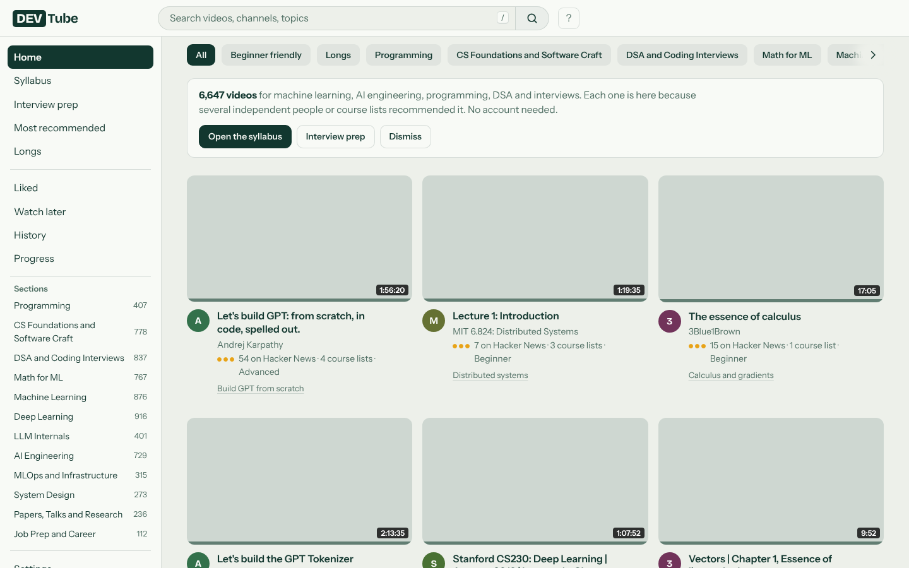
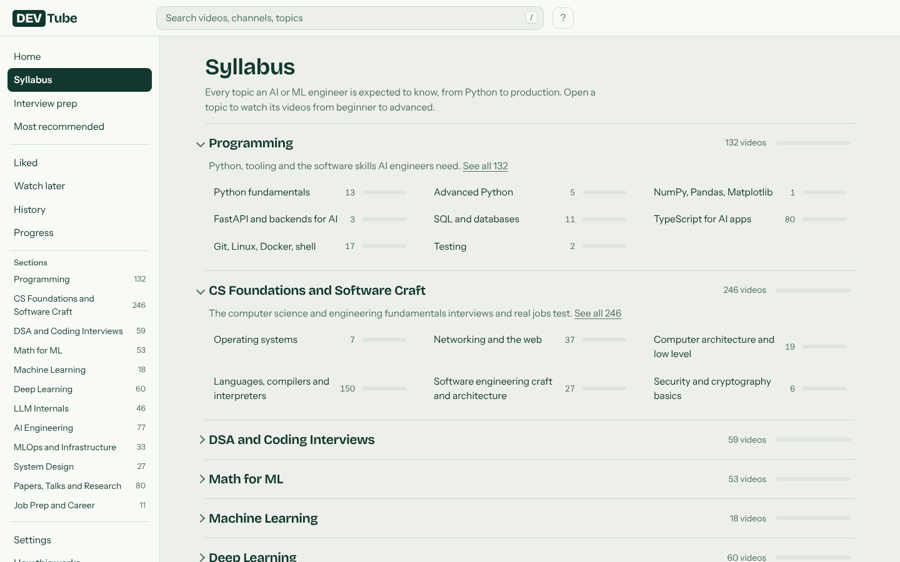
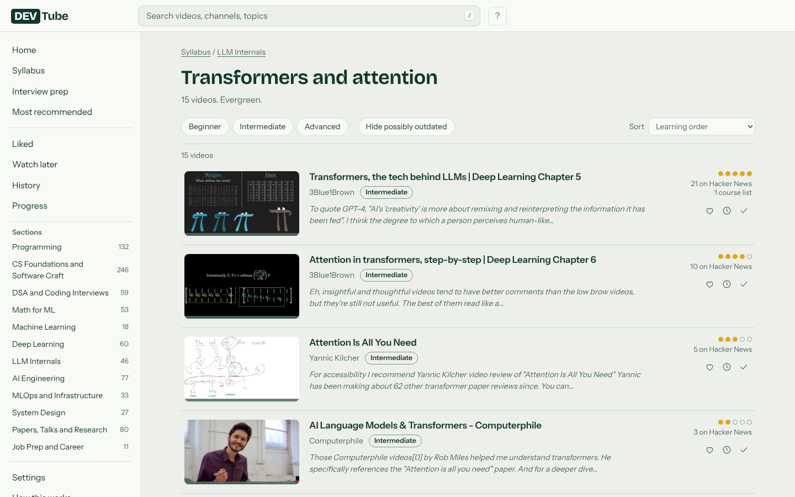
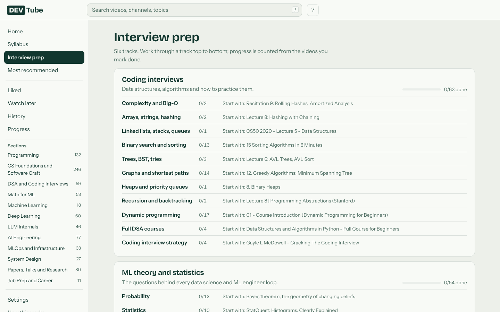
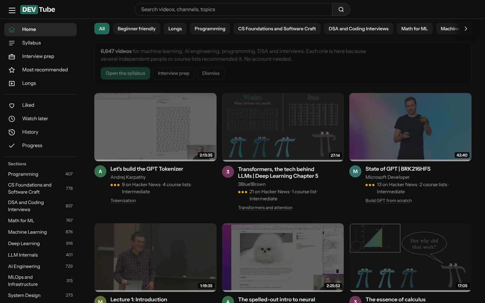
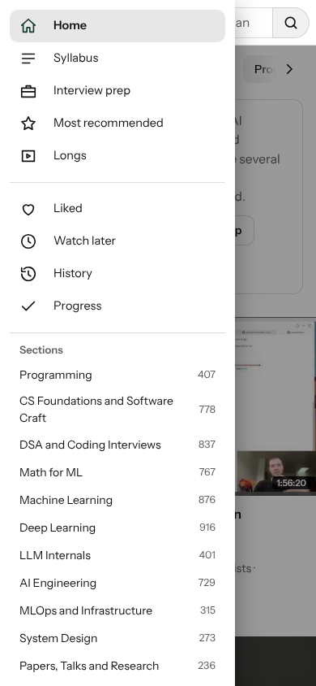

# DEV Tube

**A YouTube for AI and ML engineers, with no algorithm: only videos that several independent people and course lists recommend.**

DEV Tube is a free, static website that collects the best YouTube videos for machine learning, AI engineering, programming, DSA, system design and job prep, and lays them out as a syllabus. A video is listed only when more than one independent source vouches for it: Hacker News commenters, university course pages, GitHub roadmaps, and a short list of trusted channels. It has no accounts, no tracking and no backend. Everything you do (likes, watch later, progress) stays in your own browser.

Inspired by Andrej Karpathy's [HackerTube](https://hackertube.org). DEV Tube narrows the idea to one audience and adds a learning order, freshness scoring and an interview-prep layer.

---

## What You Can Do

- Browse a YouTube-style home feed with topic chips, hover previews and a three-dot menu on every video
- Follow a **syllabus** of 12 sections and about 100 topics, from Python to LLM internals to MLOps
- See **why** each video is here: how many Hacker News users and course lists recommended it, shown as amber vouch dots
- Spot **outdated** tutorials: every video has a freshness bar, and old tool-specific videos are tagged "May be outdated"
- Save videos to **Liked**, **Watch later** and **Done**, with a progress page, and undo any action
- Use keyboard shortcuts (`j` / `k` to move, `w` to save, `d` to mark done, `/` to search)
- Open **Explore** for "What's happening in AI": trending stories from Hacker News, official lab blogs, newsletters, new papers and open-source repos, with save, read and "new since your last visit" markers
- Open **Pro-Scroll** for a vertical feed of productive YouTube Shorts (AI, coding tips, DSA, systems, math, career, focus) with a daily goal, streak, save and "got it" actions, and a prompt to move on to a full lecture when you finish
- Open **Ask AI** (Gemini) to get recommendations and playlists built from the catalogue. It asks clarifying questions first, can save playlists, and can add any YouTube link to your own copy of DEV Tube
- Switch between light and dark themes, and pick a mid-video or uploader thumbnail
- Export your progress as a file, or download the full dataset and build your own version

## Who This README Is For

Anyone. You do not need to be a developer to run it. If you only want to **watch**, open the live site (add the link here once deployed). If you want to **run or rebuild it**, the steps below are written for beginners.

---

## Setup Option 1: Run The Site (no keys needed)

The data is already built, so the site runs as is.

### Step 1: Install Node.js
Install Node.js **20 or newer** from [nodejs.org](https://nodejs.org).

### Step 2: Get the project
```bash
git clone https://github.com/dhrma-tech/dev-tube.git
cd dev-tube/site
```

### Step 3: Install and start
```bash
npm install
npm run dev
```

### Step 4: Open it
Go to `http://localhost:5173` in your browser.

---

## Setup Option 2: Rebuild The Data (bigger and fresher catalogue)

The data pipeline is in Python. It works without any key, but a free YouTube key adds durations, publish dates and whole channels and playlists, which makes the catalogue much larger.

### Step 1: Install Python packages
Python 3.10 or newer is required.
```bash
cd pipeline
pip install -r requirements.txt
```

### Step 2: Run without keys (smaller result)
```bash
python run_all.py
```

### Step 3: Add a YouTube API key (recommended, free)
1. Open [Google Cloud Console](https://console.cloud.google.com) and create a project.
2. Enable **YouTube Data API v3** under APIs and Services, then Library.
3. Create an **API key** under Credentials, and restrict it to that API.
4. Set it in your terminal and run:

```bash
# macOS / Linux
export YT_API_KEY="your-key"
# Windows PowerShell
$env:YT_API_KEY="your-key"

python run_all.py --api --skip-hn
```

### Step 4 (optional): Clean labels with an LLM
```bash
export ANTHROPIC_API_KEY="your-key"
python run_all.py --api --llm --skip-hn
```

### Step 5: Rebuild the site
```bash
cd ../site
npm run build
```
The finished static site is in `site/dist`.

---

## Product Preview

### Home


### Syllabus


### Topic page


### Watch page


### Interview prep


### Dark theme and mobile



---

## How It Works

1. **Collect.** The pipeline reads the public Hacker News archive and extracts every YouTube link from comments. It also reads GitHub awesome-lists, university syllabus pages, and a list of trusted channels.
2. **Check.** Each video is checked through YouTube oEmbed so deleted or blocked videos are dropped. With an API key it also gets duration, publish date, description and tags.
3. **Gate.** A video becomes a candidate only if it has a recommending comment, a listing in a curated source, or comes from a trusted channel.
4. **Classify.** Rules (and optionally Claude Haiku) place each video into one topic of the syllabus and give it a level: beginner, intermediate or advanced.
5. **Score.** Score = vouch signal × (0.5 + 0.5 × freshness). The vouch signal counts distinct Hacker News users, recommending comments, course lists and channel trust.
6. **Freshness.** Freshness = 0.5 ^ (age ÷ half-life). Half-life is 10 years for evergreen topics, 3 years for semi-fresh and 1 year for fast-moving ones. A non-evergreen video below 0.4 is tagged "May be outdated".
7. **Export.** Up to 150 videos per topic are written to JSON for the site, plus a downloadable data zip with a `DATA.md` file.

## Explore: What's Happening In AI

The Explore page is built from free sources, with no keys:

| Source | What it adds |
|---|---|
| Hacker News (Algolia API) | AI stories from the last 3 days, ranked by points and comments |
| Lab blogs and newsletters | OpenAI, Anthropic, Google DeepMind, Google AI, Google Research, Microsoft Research, NVIDIA, Hugging Face, Simon Willison, Import AI, Latent Space |
| Hugging Face daily papers | Most upvoted new papers |
| GitHub search | New AI repos created this week, ranked by stars |
| Lobsters | AI and ML tags |

`pipeline/07_fetch_news.py` writes `site/public/data/news.json`. Run `python pipeline/07_fetch_news.py` to refresh it, then commit the file to redeploy. To refresh automatically every 2 hours, move `docs/news-workflow.yml` to `.github/workflows/news.yml`. Reddit blocks automated access, so it is tried but usually skipped.

## Pro-Scroll: Productive Shorts

Pro-Scroll is a swipeable Shorts feed that stops when you have had enough. Pick a daily goal (5, 10, 20 or 30). A Short counts after 3 seconds on screen. When you reach the goal, the page points you to a full lecture or the syllabus instead of scrolling forever.

No API key is needed. Every YouTube channel has a Shorts-only playlist (the channel id with `UC` replaced by `UUSH`), and its public RSS feed lists the 15 latest Shorts with title, date and views. `pipeline/08_fetch_shorts.py` reads those feeds for about 200 channels (a hand-picked list plus the top channels in the catalogue), then:

1. Drops sponsored, off-topic and entertainment titles, and requires an on-topic title.
2. Sorts each Short into a track by title keywords.
3. Scores it: log of views × freshness (1 year half-life), plus a boost for beating the channel's own median.
4. Keeps at most 8 per channel and writes `site/public/data/shorts.json`.

In the feed, the same channel never appears twice in a row, Shorts you have already seen go to the back, and each visit shuffles the order slightly. Keys: `j` / `k` move, `s` saves, `d` marks "got it", `m` toggles sound, space pauses.

Only YouTube is supported. Instagram and X have no open feed, their embeds need their own scripts and a login, and they block automated access.

## Ask AI

Ask AI is a chat page powered by Gemini. It never invents videos: it can only call these tools, and every video id is checked against the catalogue before it is shown.

| Tool | What it does |
|---|---|
| `ask_user` | Shows 1 to 4 clarifying questions as tappable options (goal, level, hours per week, length, deadline) and waits for the answers |
| `search_catalogue` | Searches the 6,600+ videos by topic, level, length and freshness, in the browser |
| `show_playlist` | Shows an ordered playlist card with a Save button |
| `fetch_youtube` | Reads a pasted YouTube link (title, channel, length) through `api/video.js`, no key needed |
| `propose_video` | Offers to add that video, with a topic and level. It only joins the catalogue after the user taps Add |

Playlists and added videos are stored in the browser (`localStorage`). Nothing is added for other visitors.

**Gemini key setup.** The site is static, so a key in the browser would be public. Two ways to run it, and both can be on at once:

1. **Shared AI (recommended).** In Vercel, open Settings, Environment Variables and add `GEMINI_API_KEY` (get one free in [Google AI Studio](https://aistudio.google.com/apikey)). The function `api/chat.js` holds the key, only forwards function-calling requests, caps output size, and limits each visitor per day (`AI_DAILY_LIMIT`, default 60 calls). The limit is kept in memory, so it is best effort. Optional: `GEMINI_MODEL` (default `gemini-flash-latest`).
2. **Bring your own key.** A visitor pastes their own key in the Gemini key box on the page. It is stored only in their browser and is used to call Gemini directly, with its own quota.

The `api/` functions only run on Vercel, not in `vite dev`. Locally, use the paste-your-own-key box.

## Tech Stack

- **Site:** Vite, React 18, TypeScript (strict), plain CSS, hash routing, no server
- **State:** your browser's localStorage, no accounts
- **Fonts:** Bricolage Grotesque and Instrument Sans, bundled locally (no CDN)
- **Pipeline:** Python, DuckDB over the Hugging Face `open-index/hacker-news` Parquet files, YouTube oEmbed and Data API v3
- **Videos:** embedded with `youtube-nocookie.com`

## Common Commands

| Command | What it does |
|---|---|
| `npm run dev` | Start the local site (from `site/`) |
| `npm run build` | Type-check and build the static site to `site/dist` |
| `npm run preview` | Serve the built site locally |
| `python run_all.py` | Run the whole pipeline without keys |
| `python run_all.py --api --skip-hn` | Run with the YouTube API, reusing cached Hacker News data |
| `python run_all.py --api --llm --skip-hn` | Also run the optional Claude Haiku labeling pass |

## Environment Variables

These are used only by the Python pipeline. The website itself never uses any key.

| Variable | Required | What it does |
|---|---|---|
| `YT_API_KEY` | Optional, recommended | Free YouTube Data API key. Adds durations, publish dates, channel and playlist expansion |
| `ANTHROPIC_API_KEY` | Optional | Enables the Claude Haiku labeling pass for better topics and levels |

Never commit a key. `.env` files are ignored by `.gitignore`.

---

## Project Status

A finished single-purpose static site. The catalogue depends on the data you build or ship, and grows when you run the pipeline with an API key.

## Known Limitations

- Without a YouTube API key, the catalogue is small and has no durations or exact publish dates
- Topic labels come from keyword rules unless you run the LLM pass, so some videos are misfiled
- Hacker News leans toward programmers, so topics like math for ML and research papers are thinner
- A recommendation is a signal, not proof a video is good
- No automated tests yet; the site was checked with browser tests during development
- Videos can be deleted or blocked on YouTube later, so the data should be refreshed from time to time

## Privacy and Your Data

- No accounts, no analytics, no cookies set by DEV Tube
- Likes, history and progress stay in your browser and never leave it
- Hover previews and the watch page load YouTube embeds through `youtube-nocookie.com`; YouTube sees those requests
- Use **Settings, Erase everything** to clear all local data

## Data Sources and Licenses

- Hacker News data: [`open-index/hacker-news`](https://huggingface.co/datasets/open-index/hacker-news) on Hugging Face, under ODC-By 1.0
- Video titles, thumbnails and channel names belong to their owners and are shown through YouTube
- This repository's code is MIT licensed

## Folder Structure

```text
dev-tube/
├── pipeline/            Python data pipeline
│   ├── 01_extract_hn.py       read Hacker News archive, extract YouTube links
│   ├── 02_extract_sources.py  read GitHub lists, syllabi, channels
│   ├── 03_merge.py            combine signals, apply candidate gate
│   ├── 04a_oembed.py          availability, title, channel (no key)
│   ├── 04b_youtube_api.py     duration, dates, channel and playlist expansion
│   ├── 05_classify.py         rule based topic and level
│   ├── 05b_llm_label.py       optional Claude Haiku labels
│   ├── 06_score_export.py     scoring, freshness, JSON and data zip
│   ├── 07_fetch_news.py       Explore page news (free sources)
│   ├── 08_fetch_shorts.py     Pro-Scroll Shorts (no key)
│   ├── build_taxonomy.py      generates the syllabus
│   └── run_all.py             runs everything in order
├── site/                Vite + React static site
│   ├── api/                   Vercel functions: chat.js (Gemini proxy), video.js (YouTube metadata)
│   └── src/                   App, views, components, store, data, styles, ai, aipage
├── data/
│   ├── seeds.json             channels, syllabus pages, GitHub lists
│   └── taxonomy.json          sections and topics (generated)
├── docs/
│   ├── PLAN.md                build plan
│   └── shots/                 screenshots
├── LICENSE
└── README.md
```

## Project Files To Know

| File | Purpose |
|---|---|
| `data/seeds.json` | The curated starting points: trusted channels, syllabus pages and GitHub lists. Edit this to add sources |
| `pipeline/build_taxonomy.py` | Defines the syllabus sections, topics and their keywords |
| `pipeline/06_score_export.py` | Scoring and freshness logic |
| `site/src/store.ts` | All browser-side state (likes, later, done, hidden, settings) |
| `site/src/components.tsx` | Video card, hover preview, menu and toasts |
| `site/src/views.tsx` | Every page of the site |
| `docs/PLAN.md` | Why the project works the way it does |

## Important Notice Before Deploying

The site is fully static and safe to host anywhere (Vercel, Cloudflare Pages, GitHub Pages). Build command `npm run build`, output folder `site/dist`, root folder `site`. Never put an API key into the `site` folder.

## Contributing

Issues and pull requests are welcome, especially for new trusted channels, syllabus sources and better topic keywords. Keep changes small and describe what source or rule you changed.

## License

MIT. See [LICENSE](LICENSE).

## Author

Built by **Dharmaraj Aparadh** ([@dhrma-tech](https://github.com/dhrma-tech)).
